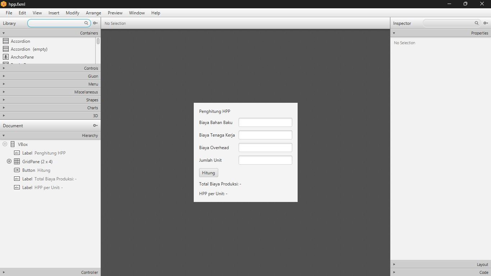
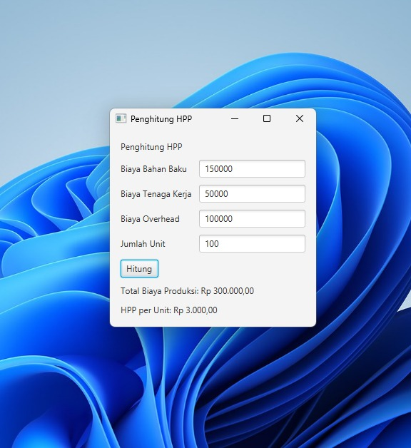
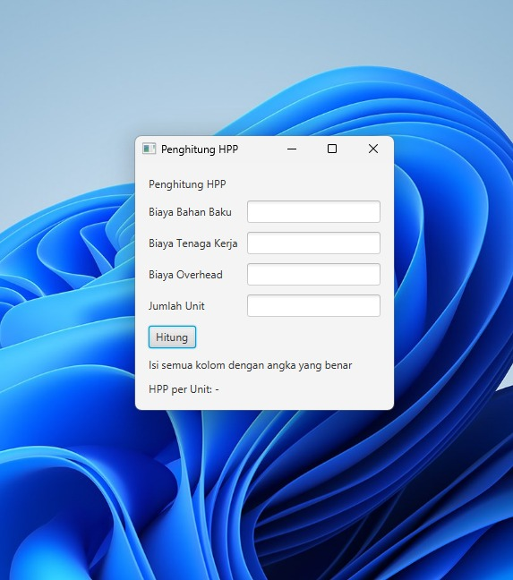

# Penghitung HPP (JavaFX)

Aplikasi desktop sederhana untuk menghitung Harga Pokok Produksi (HPP) menggunakan Java, JavaFX, dan Scene Builder.

## Identitas

- Nama: Muhammad Angger Satrio
- NIM: 2501781

## Rumus

```
Total Biaya Produksi = Biaya Bahan Baku + Biaya Tenaga Kerja + Biaya Overhead
HPP per Unit = Total Biaya Produksi / Jumlah Unit
```

## Fitur

- Input biaya bahan baku, tenaga kerja, overhead, dan jumlah unit
- Menampilkan total biaya produksi dan HPP per unit
- Pesan kesalahan jika input kosong, bukan angka, atau jumlah unit 0

## Tampilan Aplikasi

Desain di Scene Builder:



Hasil perhitungan setelah tombol Hitung diklik:



Pesan kesalahan jika kolom dikosongkan:



## Teknologi

- Java
- JavaFX
- Scene Builder
- Maven
- NetBeans

## Struktur File

```
src/main/java
  main/Main.java                 Kelas utama untuk membuka jendela aplikasi
  controller/HppController.java  Logika perhitungan HPP
src/main/resources
  view/hpp.fxml                  Tampilan antarmuka dari Scene Builder
```

## Cara Menjalankan

1. Pastikan JDK 17 atau lebih baru sudah terpasang.
2. Clone repo ini:
   ```
   git clone https://github.com/muhammadanggersatrio-dev/HPP-by-Angger
   ```
3. Buka project di NetBeans.
4. Klik kanan project, pilih Run Maven > Goals, lalu isi dengan:
   ```
   javafx:run
   ```

Atau lewat terminal di folder project:

```
mvn javafx:run
```

## Cara Pakai

1. Isi keempat kolom dengan angka.
2. Klik tombol Hitung.
3. Hasil total biaya dan HPP per unit muncul di bawah tombol.

Contoh: bahan baku 150000, tenaga kerja 50000, overhead 100000, jumlah unit 100. Total biaya produksi Rp 300.000,00 dan HPP Rp 3.000,00 per unit.
